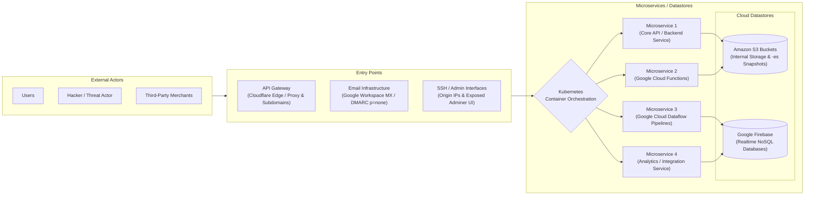

# Reconnaissance & Footprinting Assessment: OSINT, Active Network Scanning & Attack Surface Prioritization


> **Executive Summary:** This project documents a structured Passive and Active Reconnaissance & Footprinting assessment conducted against an authorized target organization (`altschoolafrica` / sensitive endpoints redacted as `confidential`). Utilizing an offensive OSINT and network enumeration toolchain—including `Amass`, `Recon-ng`, `cloud_enum`, `dig`, `dnsrecon`, `dnsenum`, `theHarvester`, `Apollo.io`, `Shodan`, and `Nmap`—the engagement mapped the organization's external attack surface, deduced its multi-cloud backend architecture (Kubernetes, Google Cloud Functions, Google Cloud Dataflow, Firebase, and AWS S3), evaluated Cloudflare WAF evasion behavior, and prioritized the top five high-risk targets with actionable remediation strategies.

| Field | Detail |
| :--- | :--- |
| **Target Organization** | `altschoolafrica` (Sensitive hostnames/IPs redacted as `confidential`) |
| **Engagement Type** | Passive and Active Reconnaissance & Footprinting Assessment |
| **Assessment Date** | April 16, 2026 |
| **Assessment Status** | Low Risk Assessment (Completed) |
| **Consultant** | Chinaza Nnamani |

---

## Table of Contents
- [Tools Used](#tools-used)
- [Skills Learned](#skills-learned)
- [1. Problem Statement & Objectives](#1-problem-statement--objectives)
- [2. Architecture & Design Overview](#2-architecture--design-overview)
- [3. Technology Stack & Tooling](#3-technology-stack--tooling)
- [4. Full Documentation Index](#4-full-documentation-index)
- [5. Implementation Walkthrough](#5-implementation-walkthrough)
  - [Phase 1: Passive Reconnaissance (OSINT)](#phase-1-passive-reconnaissance-osint)
  - [Phase 2: Active Scanning & Firewall Evasion Testing (Nmap)](#phase-2-active-scanning--firewall-evasion-testing-nmap)
  - [Phase 3: Backend Architecture Deduction & Target Prioritization](#phase-3-backend-architecture-deduction--target-prioritization)
- [6. Validation, Testing & Proof of Work](#6-validation-testing--proof-of-work)
- [7. Key Challenges & Trade-Offs](#7-key-challenges--trade-offs)
- [8. Future Enhancements](#8-future-enhancements)
- [Author & Contact](#author--contact)

---

## Tools Used

**Operating System & Virtualization**  


**Passive Reconnaissance & OSINT**  


**DNS Enumeration & Active Scanning**  


---

## Skills Learned

**Reconnaissance & Threat Intelligence**  


**Network Scanning & Attack Surface Modeling**  


---

## 1. Problem Statement & Objectives

### Background & Risk / Bottleneck
Modern cloud-native organizations frequently distribute their infrastructure across content delivery networks (CDNs) like Cloudflare, containerized microservices (Kubernetes), serverless functions (Google Cloud Functions), and managed cloud datastores (AWS S3 and Google Firebase). While edge proxies protect the primary domain, shadow IT, legacy DNS records, exposed staging subdomains, unauthenticated cloud storage buckets, and permissive email authentication policies (`DMARC p=none`, missing `DNSSEC`) often expose the underlying infrastructure to attackers. Without systematic reconnaissance and attack-surface mapping, security teams remain blind to origin IP leaks and exposed administrative interfaces that bypass Web Application Firewalls (WAFs).

### Core Objectives
* **Objective 1:** Differentiate passive vs. active reconnaissance techniques and apply both methodologies systematically within strict Rules of Engagement.
* **Objective 2:** Perform Open-Source Intelligence (OSINT) gathering to enumerate public-facing information about the target domain (`altschoolafrica` / `confidential`), including subdomains, cloud storage buckets, DNS records, and employee metadata.
* **Objective 3:** Execute active network scanning using `Nmap` to discover live hosts, open ports, running services, and evaluate firewall/WAF behavior against stealth and packet-fragmentation scans.
* **Objective 4:** Produce a concise attack-surface Data Flow Diagram (DFD), deduce the internal microservice/datastore architecture, and prioritize the top 5 potential targets for subsequent penetration testing phases.

### Scope & Rules of Engagement (RoE)
* **In Scope:** `confidential` (`altschoolafrica.com` authorized target domain).
* **Out of Scope:** Everything not explicitly in scope (all third-party domains and subdomains outside the authorized target boundary).
* **Rules of Engagement:**
  1. Use only approved OSINT tools and the dedicated Kali Linux lab (Oracle VirtualBox or cloud lab).
  2. Document all commands, parameters, and outputs for auditability.
  3. Only scan the authorized domain provided by the organization.
  4. Keep all sensitive findings redacted (`confidential`) and within course/client boundaries—do not publish or share raw external data.
  5. Conduct the assessment with the rigor and discipline of a real-world penetration testing engagement.

> [!IMPORTANT]
> **Scope Note:** This `README.md` is a complete, self-contained penetration testing case study. All architectural diagrams, command-line workflows, findings tables, and target prioritization analyses are consolidated directly within this file without requiring separate `architecture.md`, `setup.md`, or `troubleshooting.md` files. Sensitive asset identifiers are redacted as `confidential` in compliance with the Rules of Engagement.

---

## 2. Architecture & Design Overview

### Attack-Surface Data Flow Diagram (Mermaid)
Based on the reconnaissance outputs (`cloud_enum`, `dnsenum`, `recon-ng`, and `nmap`), the target's attack-surface Data Flow Diagram (DFD) maps how external actors interact with public entry points, containerized microservices, and backend cloud datastores:



### Deduced Backend Architecture (Inferred from OSINT & DNS Naming Conventions)

#### 1. Datastores (Storage & Databases)
* **Google Firebase Realtime Databases (NoSQL):** The `cloud_enum` scan revealed several Firebase databases (`confidential`), which are used as backend datastores for real-time web and mobile applications.
* **AWS S3 Buckets (Object/Blob Storage):** Two specific S3 buckets were identified, revealing distinct backend storage patterns:
  * `confidential`: Naming convention strongly implies usage for internal application data storage or backups.
  * `confidential-es`: The `-es` suffix denotes an Elasticsearch snapshot repository or cluster backing store, pointing to the use of Elasticsearch for search or centralized logging.
* **Relational Database Management UI (`Adminer`):** Brute-force DNS enumeration via `dnsenum` discovered an exposed `Adminer` subdomain (`confidential`), confirming that the organization operates an internal relational database (such as MySQL or PostgreSQL).

#### 2. Microservices & Compute Architecture
* **Container Orchestration (`Kubernetes`):** Google Cloud Functions were discovered with names explicitly referencing Kubernetes (`confidential`), strongly indicating that core backend microservices are containerized.
* **Serverless Functions (`Google Cloud Functions`):** Enumeration confirmed the organization relies on Google Cloud Functions (`confidential`) for event-driven microservices.
* **Data Processing Pipelines (`Google Cloud Dataflow`):** Asset naming containing `"Dataflow"` (`confidential`) indicates the use of Google Cloud Dataflow for stream or batch data processing pipelines.
* **Domain-Driven Service Routing (Inferred from DNS):** Several discovered subdomains indicate a microservice architecture where distinct application functions are segmented into dedicated environments or APIs:
  * `confidential` — Core API / backend service.
  * `confidential` — Atomic components or a dedicated internal service.
  * `confidential` — Integration or API gateway service.
  * `confidential` — Data serving or analytics service.

---

## 3. Technology Stack & Tooling

| Category | Tool / Platform | Role in This Project | Why It Was Chosen |
| :--- | :--- | :--- | :--- |
| **Attack Platform** | Kali Linux (Oracle VirtualBox) | Primary offensive security workstation | Pre-configured with industry-standard OSINT and network scanning utilities |
| **Subdomain Enumeration** | `OWASP Amass` & `Recon-ng` | Passive subdomain harvesting (`hackertarget` module) | Aggregates certificate transparency logs and passive DNS datasets without touching target servers |
| **Cloud Asset Discovery** | `cloud_enum` (`cloud_enum.py`), Google Dorks, Shodan | Multi-cloud enumeration across AWS S3, GCP Cloud Functions, and Firebase | Automates keyword-driven permutation checks across AWS, Azure, and GCP storage/compute endpoints |
| **DNS & Mail Footprinting** | `dig`, `dnsrecon`, `dnsenum` (v1.3.1) | Enumerating `A`, `AAAA`, `NS`, `MX`, `TXT`, `CNAME`, `DMARC`, and `DNSSEC` status | Identifies origin IP leaks, mail providers (Google Workspace), DNSSEC gaps, and hidden admin subdomains |
| **Identity & Email OSINT** | `theHarvester` & `Apollo.io` | Harvesting corporate email patterns, job titles, seniority, and locations | Maps organizational hierarchy and email formatting for phishing risk assessment |
| **Passive Vulnerability Lookup** | Shodan Web UI & Nmap `shodan-api` NSE | Querying pre-indexed open ports and banners without active probing | Cross-references target IPs (`172.67.216.82`, `104.21.57.155`) against Shodan's global dataset |
| **Active Network Scanning** | `Nmap` (v7.98) | Host discovery (`-sn`), full port sweep (`-p-`), aggressive (`-A`), SYN stealth (`-sS`), and fragmented (`-f`) scans | Empirically validates live hosts, open Cloudflare/Nginx ports, and WAF packet-filtering behavior |

---

## 4. Full Documentation Index

All project documentation, command syntax, terminal outputs, and analytical findings are self-contained within this `README.md` file:

```text
reconnaissance-footprinting-project/
├── _RECONNAISSANCE__FOOTPRINTING_REPORT_(1).pdf   # Original Penetration Testing Reconnaissance Report
└── README.md                                      # Complete self-contained case study & technical runbook
```

| Section Link | Description |
| :--- | :--- |
| [**1. Problem Statement & Objectives**](#1-problem-statement--objectives) | Assessment context, objectives, scope boundaries, and Rules of Engagement (RoE). |
| [**2. Architecture & Design Overview**](#2-architecture--design-overview) | Attack-Surface Data Flow Diagram (DFD) and inferred multi-cloud backend architecture. |
| [**3. Technology Stack & Tooling**](#3-technology-stack--tooling) | OSINT, DNS, cloud enumeration, and active scanning toolchain matrix. |
| [**5. Implementation Walkthrough**](#5-implementation-walkthrough) | Step-by-step commands and terminal outputs for Passive OSINT and Active Nmap scanning. |
| [**6. Validation, Testing & Proof of Work**](#6-validation-testing--proof-of-work) | Passive findings sensitivity matrix, Nmap scan results, open port table, and Top 5 target prioritization. |
| [**7. Key Challenges & Trade-Offs**](#7-key-challenges--trade-offs) | Analysis of Cloudflare WAF packet filtering, OS detection skew, and origin IP exposure. |
| [**8. Future Enhancements**](#8-future-enhancements) | Defensive remediation roadmap and next-phase vulnerability assessment actions. |

---

## 5. Implementation Walkthrough

### Phase 1: Passive Reconnaissance (OSINT)
Passive reconnaissance was executed first to gather maximum intelligence on the target organization (`altschoolafrica` / `confidential`) from open-source intelligence feeds, public DNS resolvers, search engines, and cloud registries without sending disruptive traffic directly to the target infrastructure.

#### 1. Subdomain Enumeration (`Amass` & `Recon-ng`)
* Executed passive subdomain enumeration using `OWASP Amass` to map FQDNs, `NS` records, `A` records, and `AAAA` records.
* Loaded the `recon/domains-hosts/hackertarget` module inside the `Recon-ng` framework to cross-verify discovered hostnames.

<details>
<summary><strong>Click to expand: Subdomain Enumeration Commands & Terminal Output</strong></summary>

```bash
# Passive subdomain enumeration with OWASP Amass
amass enum -passive -d confidential

# Example terminal output captured in Kali Linux:
# altschoolafrica.com (FQDN) --> ns_record --> ...
# altschoolafrica.com (FQDN) --> a_record  --> ...
# altschoolafrica.com (FQDN) --> aaaa_record --> ...
```

```text
# Inside the Recon-ng console:
modules load recon/domains-hosts/hackertarget
options set SOURCE confidential
run
```

</details>

#### 2. Public Cloud Asset Discovery (`Google Dorking`, `Shodan`, `cloud_enum`)
* Used targeted Google Dorks and Shodan search queries to hunt for open directory listings and exposed Amazon S3 buckets associated with the organization.
* Ran `cloud_enum.py` using the keyword `altschoolafrica` to enumerate multi-cloud storage buckets, Google Firebase Realtime Databases, Google Cloud Functions, and Google Cloud Dataflow assets.

<details>
<summary><strong>Click to expand: Public Cloud Asset Discovery Commands & Queries</strong></summary>

```text
# Google Dork for exposed Amazon S3 buckets:
site:s3.amazonaws.com "confidential"

# Shodan Dork for open S3 directory listings:
hostname:confidential http.title:"Index of /" "s3.amazonaws.com"
```

```bash
# Multi-cloud asset enumeration using cloud_enum in Kali Linux venv
python3 cloud_enum.py -k altschoolafrica
```

</details>

#### 3. DNS Records (`A`, `MX`, `TXT`, `CNAME`, `DNSSEC`) & WHOIS Lookup (`dig`, `dnsrecon`, `dnsenum`)
* Queried DNS records using `dig` against Cloudflare's public resolver (`1.1.1.1#53`).
* Executed standard DNS enumeration using `dnsrecon -d confidential -t std` to inspect `SOA`, `NS`, `MX` (`aspmx.l.google.com`), `A`, `TXT`, `DMARC` (`p=none`), and `DNSSEC` configurations.
* Executed brute-force subdomain and zone enumeration using `dnsenum` (`v1.3.1`), which uncovered staging subdomains, origin `A` records, and an exposed `Adminer` database management subdomain.

<details>
<summary><strong>Click to expand: DNS Enumeration Commands & Sample Output</strong></summary>

```bash
# Query DNS A records via dig
dig confidential

# Standard DNS record and DNSSEC check via dnsrecon
dnsrecon -d confidential -t std

# Comprehensive DNS enumeration and subdomain brute-forcing via dnsenum
dnsenum confidential
```

```text
; <<>> DiG 9.20.20-1-Debian <<>> altschoolafrica.com
;; global options: +cmd
;; Got answer:
;; ->>HEADER<<- opcode: QUERY, status: NOERROR
;; flags: qr rd ra; QUERY: 1, ANSWER: 2
;; QUESTION SECTION:
;altschoolafrica.com.           IN      A

;; ANSWER SECTION:
altschoolafrica.com.    300     IN      A       172.67.216.82
altschoolafrica.com.    300     IN      A       104.21.57.155

;; Query time: 196 msec
;; SERVER: 1.1.1.1#53(1.1.1.1) (UDP)
;; MSG SIZE  rcvd: 80
```

</details>

#### 4. Email Addresses & Employee Enumeration (`theHarvester` & `Apollo.io`)
* Executed `theHarvester` querying DuckDuckGo and LinkedIn to extract publicly indexed corporate email addresses and employee names.
* Leveraged `Apollo.io` filtering by job titles (`HR Manager`, `Talent Acquisition Lead`, `Head of People`, `Learning and Development Manager`, `Project Manager`, `Program Manager`, `Product Manager`), seniority levels (`Manager`, `Director`, `Head`, `VP`), and regional locations (`Nigeria`, `Kenya`, `Ghana`) to map high-value personnel for social engineering risk analysis.

<details>
<summary><strong>Click to expand: Email & Personnel OSINT Command</strong></summary>

```bash
# Harvest emails and employee names via DuckDuckGo and LinkedIn
theHarvester -d confidential -b duckduckgo,linkedin
```

</details>

#### 5. Shodan Lookups for Known Services (`Shodan Web UI` & `Nmap shodan-api`)
* Queried the Shodan Web Interface (`hostname:altschoolafrica.com`) and executed Nmap's `shodan-api` NSE script with `-sn` (no port scan) to passively check Shodan's database for pre-indexed services on the resolved Cloudflare edge IPs (`172.67.216.82` and `104.21.57.155`).

<details>
<summary><strong>Click to expand: Nmap Shodan API Script Command & Output</strong></summary>

```bash
# Passive Shodan lookup using Nmap NSE script
nmap --script shodan-api --script-args shodan-api.apikey=<REDACTED_SHODAN_API_KEY> -sn confidential
```

```text
Starting Nmap 7.98 ( [https://nmap.org](https://nmap.org) ) at 2026-04-15 15:59 -0400
Nmap scan report for altschoolafrica.com (172.67.216.82)
Host is up (0.018s latency).
Other addresses for altschoolafrica.com (not scanned): 104.21.57.155 2606:4700:...

Post-scan script results:
|_shodan-api: Shodan Done: 0 hosts up.
Nmap done: 1 IP address (1 host up) scanned in 4.74 seconds
```

</details>

---

### Phase 2: Active Scanning & Firewall Evasion Testing (Nmap)
Following passive OSINT collection, controlled active scanning was conducted using `Nmap v7.98` to verify host availability, enumerate open TCP ports across all 65,535 ports, fingerprint service versions, and test how the Cloudflare edge firewall responds to SYN stealth and fragmented packet scans.

* **Step 1 — Host Discovery Scan (`-sn`):** Sent ICMP and TCP probes without scanning ports to confirm the target host was online.
* **Step 2 — Full-Port Service & Version Detection (`-sC -sV -p-`):** Scanned all 65,535 TCP ports with default NSE scripts and version detection, uncovering 14 open ports including non-standard Cloudflare HTTP/HTTPS proxy and `nginx` ports (`2052`, `2053`, `2082`, `2083`, `2086`, `2087`, `2095`, `2096`, `8080`, `8443`, `8880`).
* **Step 3 — Aggressive Scan (`-A`):** Enabled OS detection, version detection, script scanning, and traceroute, confirming ports `80`, `443`, `8080`, and `8443` run Cloudflare's HTTP proxy service and mapping a 5-hop traceroute to the Cloudflare edge server.
* **Step 4 — TCP SYN Stealth Scan (`-sS`):** Scanned the top 1,000 TCP ports, identifying 5 open ports (`80`, `443`, `587`, `8080`, `8443`) while 995 ports were marked `filtered` (dropped by the firewall).
* **Step 5 — Fragmented TCP SYN Stealth Scan (`-sS -sV -O -f`):** Attempted firewall evasion via packet fragmentation (`-f`). The Cloudflare firewall blocked all 1,000 fragmented probes (marking all 1,000 ports as `filtered`), causing Nmap's OS detection engine to guess inaccurately (suggesting Cisco, APC, or Synology devices).

<details>
<summary><strong>Click to expand: Active Nmap Scanning Commands</strong></summary>

```bash
# 1. Host discovery scan (Ping sweep)
nmap -sn -oN nmap_recon.txt confidential

# 2. Full 65,535 TCP port scan with default scripts and service version detection
nmap -sC -sV -p- -oN nmap_recon1.txt confidential

# 3. Aggressive scan (OS detection, version detection, script scanning, and 5-hop traceroute)
nmap -A -oN nmap_recon2.txt confidential

# 4. TCP SYN stealth scan across top 1,000 ports
sudo nmap -sS -oN nmap2.txt confidential

# 5. Fragmented TCP SYN stealth scan with version & OS detection (WAF evasion test)
sudo nmap -sS -sV -O -f -oN nmap_frag.txt confidential
```

</details>

---

### Phase 3: Backend Architecture Deduction & Target Prioritization
By correlating the outputs from `cloud_enum`, `dnsenum`, `dnsrecon`, `recon-ng`, and `Nmap`, we mapped the target's internal microservice and datastore architecture and ranked the **Top 5 Potential Targets** by exploitability and business impact:
1. **Subdomain Origin IPs (`A` Record Leaks)** bypassing the Cloudflare WAF and exposing the raw AWS backend.
2. **Exposed `Adminer` Web Database Interface** providing a direct login surface to internal relational databases.
3. **AWS S3 Buckets & Google Firebase Realtime Databases** susceptible to unauthenticated read/write ACL misconfigurations.
4. **Exposed Staging & Development Environments** running with weaker credentials, verbose debugging, and reduced monitoring.
5. **Permissive Email Security Policy (`DMARC p=none` & missing `DNSSEC`)** enabling high-confidence domain spoofing and targeted phishing.

---

## 6. Validation, Testing & Proof of Work

### 1. Passive Reconnaissance (OSINT) Findings Matrix

| Action Performed | Sources / Tools | Commands / Queries Executed |
| :--- | :--- | :--- |
| **Subdomain Enumeration** | `Amass`, `Recon-ng` | `amass enum -passive -d confidential`<br>`modules load recon/domains-hosts/hackertarget` -> `options set SOURCE confidential` -> `run` |
| **Public Asset Discovery** | Google Dorking, Shodan, `Cloudenum` | `site:s3.amazonaws.com "confidential"`<br>`hostname:confidential http.title:"Index of /" "s3.amazonaws.com"`<br>`python3 cloud_enum.py -k altschoolafrica` |
| **DNS Records (`A`, `MX`, `TXT`, `CNAME`) & WHOIS** | `dig`, `dnsrecon`, `dnsenum` | `dig confidential`<br>`dnsrecon -d confidential -t std`<br>`dnsenum confidential` |
| **Email Addresses & Employee Names** | `Apollo.io`, `theHarvester` | `theHarvester -d confidential -b duckduckgo,linkedin` |
| **Shodan Lookups for Known Services** | Shodan Web UI, Nmap `shodan-api` script | `nmap --script shodan-api --script-args shodan-api.apikey=<API_KEY> -sn confidential` |

### 2. OSINT Findings Confidence & Sensitivity Classification

| Finding Category | Technical Details & Observations | Confidence | Potential Sensitivity |
| :--- | :--- | :--- | :--- |
| **Subdomains** | Multiple active subdomains enumerated (`confidential`) mapping to core APIs, staging, and microservices. | **HIGH** | **PUBLIC** |
| **Public Buckets** | Two AWS S3 buckets identified (`confidential` for internal storage/backups and `confidential-es` for Elasticsearch snapshots). | **LOW** | **INTERNAL** |
| **CNAME Records** | `CNAME` aliases (`confidential`) mapping external services and CDN routing. | **HIGH** | **PUBLIC** |
| **A Records (Origin IP Leaks)** | Direct origin `A` records (`confidential`) exposing underlying AWS backend IPs outside Cloudflare's proxy. | **HIGH** | **INTERNAL** |
| **MX & DNSSEC Records** | **Mail Routing (MX):** `aspmx.l.google.com` confirms Google Workspace for corporate email.<br>**Lack of DNSSEC:** `dnsrecon` reported `[-] DNSSEC is not configured for confidential`, leaving DNS responses unsigned and vulnerable to cache poisoning/spoofing. | **HIGH** | **PUBLIC** |
| **Staging Environments** | Multiple development and staging environments (`confidential`) exposed publicly, often running with debugging enabled or weaker controls. | **MEDIUM** | **INTERNAL** |
| **Administrative Panels (`Adminer`)** | Brute-force enumeration via `dnsenum` discovered an exposed `Adminer` subdomain (`confidential`), a single-file database management tool similar to phpMyAdmin. | **LOW** | **INTERNAL** |
| **Discovered Emails** | Valid corporate email addresses and employee role mappings (`confidential`) harvested via `theHarvester` and `Apollo.io`. | **HIGH** | **INTERNAL** |

---

### 3. Active Scanning (`Nmap`) Validation Matrix

| Scan Type & Command | Scope / Target Ports | Empirical Result & Firewall Behavior | Status |
| :--- | :--- | :--- | :--- |
| **Host Discovery Scan**<br>`nmap -sn -oN nmap_recon.txt confidential` | ICMP & TCP Ping Sweep (0 ports scanned) | Sent ICMP and TCP probes without port scanning; confirmed target host (`confidential`) is online (`0.018s latency`). | **Verified** |
| **Full Service/Version Detection**<br>`nmap -sC -sV -p- -oN nmap_recon1.txt confidential` | All 65,535 TCP Ports (`-p-`) | Discovered 14 open TCP ports including non-standard Cloudflare web/proxy ports (`2052`, `2053`, `2082`, `2083`, `2086`, `2087`, `2095`, `2096`, `8080`, `8443`, `8880`), identifying Cloudflare HTTP proxies and `nginx` servers. | **Verified** |
| **Aggressive Scan**<br>`nmap -A -oN nmap_recon2.txt confidential` | Top 1,000 TCP Ports + OS/Scripts/Traceroute | Identified 5 open ports (`80`, `443`, `587`, `8080`, `8443`), confirmed `80`, `443`, `8080`, and `8443` run Cloudflare HTTP proxy, and mapped a 5-hop traceroute to the Cloudflare edge. | **Verified** |
| **TCP SYN Stealth Scan**<br>`nmap -sS -oN nmap2.txt confidential` | Top 1,000 TCP Ports | Identified 5 open ports (`80`, `443`, `587`, `8080`, `8443`); 995 ports returned `filtered` (packets dropped silently). Stealth scan did not evade the firewall. | **Verified** |
| **Fragmented SYN Stealth Scan**<br>`nmap -sS -sV -O -f -oN confidential` | Top 1,000 TCP Ports (Fragmented `-f`) | Fragmentation evasion failed completely; Cloudflare firewall blocked all 1,000 ports (`filtered`). With 0 open ports, Nmap's OS detection guessed wildly (Cisco, APC, Synology). | **Blocked by WAF** |

### 4. Enumerated Open Ports & Services Table

| Open Port (TCP) | Service | Identified Version / Banner |
| :--- | :--- | :--- |
| `80` | `http` | `Cloudflare http proxy` |
| `443` | `ssl/http` | `Cloudflare http proxy` |
| `587` | `submission?` | `Unknown (Connection failed)` |
| `2052` | `http` | `Cloudflare http proxy` |
| `2053` | `ssl/http` | `nginx` |
| `2082` | `http` | `Cloudflare http proxy` |
| `2083` | `ssl/http` | `nginx` |
| `2086` | `http` | `Cloudflare http proxy` |
| `2087` | `ssl/http` | `nginx` |
| `2095` | `http` | `Cloudflare http proxy` |
| `2096` | `ssl/http` | `nginx` |
| `8080` | `http` | `Cloudflare http proxy` |
| `8443` | `ssl/http` | `Cloudflare http proxy` |
| `8880` | `http` | `Cloudflare http proxy` |

---

### 5. Top 5 Prioritized Potential Targets for Further Testing

| Priority Rank | Target Category | Affected Asset(s) | Risk Statement & Exploitation Impact |
| :--- | :--- | :--- | :--- |
| **1 (Critical)** | **Subdomain Origin IPs** | `confidential` (Direct AWS Origin `A` Records) | These IPs completely bypass the Cloudflare WAF, exposing the true AWS backend infrastructure. This allows for direct, unmitigated active scanning and exploitation attempts without triggering edge-layer defenses or rate limiting. |
| **2 (Critical)** | **Adminer Database Interface** | `confidential` (Adminer Subdomain) | Exposes a web-based relational database management tool directly to the internet. If running an outdated version with known CVEs or protected by weak/default credentials, it provides a direct vector to total database compromise and potential Remote Code Execution (RCE). |
| **3 (High)** | **Cloud Storage & Firebase Databases** | `confidential` (S3 Buckets & Firebase Endpoints) | Cloud datastores are prone to access control misconfigurations. If any of these S3 buckets (`confidential`, `confidential-es`) or Firebase endpoints allow unauthenticated read or write access, it results in an immediate, zero-click breach of sensitive data or application logic. |
| **4 (High)** | **Staging & Development Environments** | `confidential` (Staging/Dev Subdomains) | Staging environments frequently run with verbose debugging enabled, utilize weaker testing credentials, and lack production-grade security monitoring. They often serve as the path of least resistance for establishing an initial foothold in the network. |
| **5 (Medium)** | **Email Infrastructure (DMARC & DNSSEC)** | `_dmarc` Record (`v=DMARC1; p=none`) & Unsigned DNS Zone | The permissive `p=none` DMARC policy allows malicious actors to send highly convincing, spoofed emails that appear to legitimately originate from `confidential`. Combined with harvested employee emails, this creates a high-probability vector for targeted phishing campaigns aimed at credential harvesting or payload delivery. |

---

## 7. Key Challenges & Trade-Offs

> [!NOTE]
> Documenting technical roadblocks, WAF behaviors, and analytical nuances encountered during reconnaissance demonstrates how raw scan data is validated before reporting to stakeholders.

* **Challenge 1: Cloudflare WAF Packet Filtering & Fragmented Scan Failure (`-f`)**
  * *Issue:* When attempting to evade firewall inspection using Nmap packet fragmentation (`sudo nmap -sS -sV -O -f`), the Cloudflare edge firewall dropped 100% of the fragmented packets across all 1,000 top ports, marking every port as `filtered`. Furthermore, because Nmap's OS fingerprinting algorithm (`-O`) requires at least one open and one closed TCP port to calculate TCP/IP stack quirks, it produced false-positive OS guesses (suggesting Cisco, APC, or Synology hardware).
  * *Resolution:* Contrasted the fragmented scan against unfragmented `-sS`, `-A`, and full-port `-sC -sV -p-` scans to prove that Cloudflare's edge normalizes and drops anomalous fragmented TCP packets, and relied on application-layer banners (`Cloudflare http proxy`, `nginx`) and passive DNS/cloud enumeration to deduce the true backend stack.
* **Challenge 2: Edge Proxy Obfuscation vs. Subdomain Origin IP Leakage**
  * *Issue:* Direct Nmap scans against the primary domain (`altschoolafrica.com`) only reached Cloudflare Anycast proxy IPs (`172.67.216.82` and `104.21.57.155`), masking the underlying host operating system and cloud provider.
  * *Resolution:* Pivoted to comprehensive subdomain brute-forcing (`dnsenum`) and multi-cloud permutation scanning (`cloud_enum`), which uncovered non-proxied subdomain `A` records pointing directly to AWS origin IPs as well as GCP Cloud Functions and Firebase instances.
* **Challenge 3: Terminal History Corruption in Kali Lab Environment**
  * *Issue:* During the Kali Linux VirtualBox session, Zsh emitted `zsh: corrupt history file /home/kali/.zsh_history`.
  * *Resolution:* Maintained explicit output logging flags (`-oN nmap_recon.txt`, `-oN nmap_recon1.txt`, `-oN nmap_recon2.txt`, `-oN nmap2.txt`) across all Nmap scans to guarantee that all scan artifacts were preserved independently of shell history files.

---

## 8. Future Enhancements

To remediate the identified attack-surface exposures and advance this engagement into the next phase of security testing, the following defensive and offensive actions are recommended:

### Defensive Remediation Roadmap (For the Target Organization)
- [ ] **Lock Down Origin IPs to Cloudflare Only:** Configure AWS Security Groups and Network ACLs on all origin servers to accept inbound HTTP/HTTPS traffic exclusively from official Cloudflare IP ranges, and rotate any leaked origin IP addresses so attackers cannot bypass the WAF.
- [ ] **Restrict Access to the `Adminer` Interface:** Remove the `Adminer` database management interface from the public internet immediately, or place it behind a corporate VPN / Zero-Trust Network Access (ZTNA) gateway with Multi-Factor Authentication (MFA) and IP allowlisting.
- [ ] **Audit & Harden S3 Buckets and Firebase Rules:** Enforce `Block Public Access` on all AWS S3 buckets (`confidential` and `confidential-es`) and audit Google Firebase Realtime Database security rules to ensure `.read` and `.write` permissions require authenticated tokens.
- [ ] **Isolate Staging & Development Subdomains:** Place all staging and development environments behind HTTP Basic Authentication, Cloudflare Access (Zero Trust), or internal VPNs, and ensure production data is never replicated into staging datastores.
- [ ] **Enforce Strict DMARC (`p=quarantine` / `p=reject`) & Enable DNSSEC:** Upgrade the `_dmarc` TXT record from `p=none` to `p=quarantine` and ultimately `p=reject` (with `rua`/`ruf` reporting enabled), and enable cryptographic DNSSEC signing at the domain registrar to prevent DNS cache poisoning.

### Next-Phase Penetration Testing Actions (Authorized Follow-Up)
- [ ] **Unauthenticated Cloud Datastore Verification:** Perform non-destructive read-only checks against discovered Firebase `.json` endpoints and S3 bucket ACLs to verify whether sensitive records are publicly readable.
- [ ] **Vulnerability Scanning on Origin & Staging Hosts:** Conduct targeted vulnerability assessments (`OWASP ZAP`, `Nuclei`, and authenticated `Nmap` scripts) against the prioritized staging subdomains and Adminer endpoint under explicit client authorization.

---

## Author & Contact

**Chinaza Nnamani**  
Cybersecurity Professional | Penetration Tester & Cloud Security Consultant  
* **GitHub:** [@ch1n4x4](https://github.com/ch1n4x4)
* **LinkedIn:** [linkedin.com/in/chinaza-nnamani](https://linkedin.com/in/chinaza-nnamani)